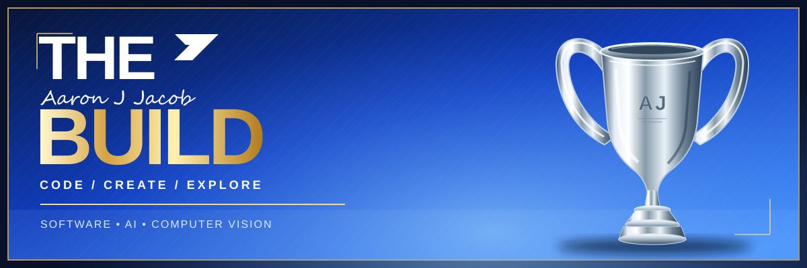

### Student developer | Full-stack applications

Building practical software with Python, React and modern web technologies.

---

## ✦ About me

I'm **Aaron Jacob**, a student developer interested in software engineering, AI and computer vision. I build web applications and hands-on prototypes, with experience across frontend interfaces, Python APIs and databases.

## ✦ Featured projects

### [CaseBridge](https://github.com/AaronJJacob2007/CaseBridge)  ·  [Live demo ↗](https://casebridge-rho.vercel.app/)
A Smart India Hackathon prototype for reviewing related institutional complaints and coordinating follow-ups across teams. Includes case management, cross-bureau comparisons and reporting.  
**Stack:** React, FastAPI, PostgreSQL

### [ReLoop](https://github.com/AaronJJacob2007/reloop-product-design)  ·  [Live demo ↗](https://reloop-product-design.vercel.app/)
A responsive marketplace prototype with product filtering, a persistent cart, simulated checkout and offline PWA support.  
**Stack:** React, TypeScript, Vite

### [Computer Vision Workshop](https://github.com/AaronJJacob2007/AIDL-Forge-2026-Computer-Vision)
A hands-on workshop repository with guided checkpoints for hand tracking and finger counting.  
**Stack:** Python, OpenCV, MediaPipe, FastAPI

## ✦ GitHub activity

Based on public GitHub data. Language proportions reflect repository contents, not proficiency.

---

## ✦ Technical skills

---

**Build with purpose. Keep improving.** ✦

Thanks for stopping by — take a look around.

