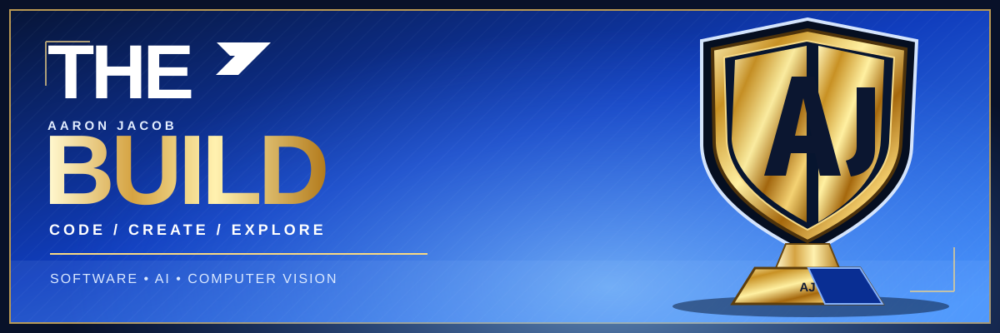

<div align="center">



### The build is always in progress.

**Software development  •  AI exploration  •  Product thinking**

[](https://github.com/AaronJJacob2007?tab=repositories)
[](https://casebridge-rho.vercel.app/)

</div>

---

## ✦ The player profile

I'm **Aaron**, a student developer who enjoys turning challenging ideas into practical, interactive experiences. I work across web apps, Python and computer vision, and I like learning by building and sharing.

```text
currently exploring  →  software engineering, AI & computer vision
building with        →  Python, React, TypeScript & FastAPI
approach             →  prototype, test, learn, improve
```

## ✦ The starting lineup

### [CaseBridge](https://github.com/AaronJJacob2007/CaseBridge)  ·  [Live demo ↗](https://casebridge-rho.vercel.app/)
A Smart India Hackathon prototype that helps teams review related institutional complaints and coordinate follow-ups. **React · FastAPI · PostgreSQL**

### [ReLoop](https://github.com/AaronJJacob2007/reloop-product-design)  ·  [Live demo ↗](https://reloop-product-design.vercel.app/)
A sustainable marketplace prototype with a responsive storefront, installable PWA and simulated shopping journey. **React · TypeScript · Vite**

### [Computer Vision Workshop](https://github.com/AaronJJacob2007/AIDL-Forge-2026-Computer-Vision)
A hands-on workshop repository exploring hand tracking and finger counting with **Python · OpenCV · MediaPipe**.

## ✦ The toolkit


---

<div align="center">

**Build with purpose. Keep improving.** ✦

<sub>Thanks for stopping by — take a look around.</sub>

</div>
